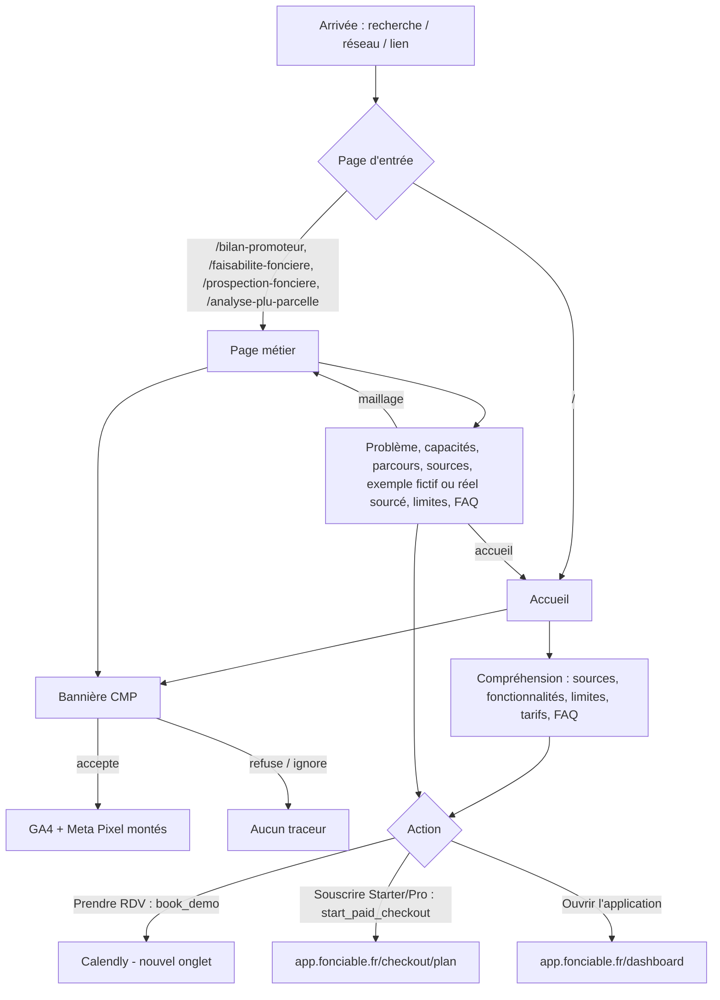

# APP_FLOW — Landing Fonciable

> Rédigé le 2026-10-20 à partir du code. **[Lu]** / **[Déduit]** / **[À CONFIRMER]**. Dépend de `PRD.md` et `TRD.md`.
> La landing n'a ni compte ni rôle : « inscription » et « paiement » se font sur `app.fonciable.fr` (hors dépôt). Le parcours principal s'arrête donc au clic sortant mesuré.

## 1. Écrans / pages

| # | Route | Fichier | Rôle | Indexée |
|---|---|---|---|---|
| E1 | `/` | `app/page.tsx` | Accueil : hero, sources, fonctionnalités, produit, périmètre/limites, tarifs, CTA, FAQ, solutions | oui |
| E2 | `/bilan-promoteur` | `app/bilan-promoteur/page.tsx` + `content/bilan-promoteur.ts` | Page métier | oui |
| E3 | `/faisabilite-fonciere` | idem `faisabilite-fonciere` | Page métier | oui |
| E4 | `/prospection-fonciere` | idem `prospection-fonciere` | Page métier | oui |
| E5 | `/mentions-legales` | `app/mentions-legales/page.tsx` | Légal | oui (priorité 0.2) |
| E6 | `/confidentialite` | `app/confidentialite/page.tsx` | RGPD / cookies | oui (priorité 0.2) |
| E7 | toute URL inconnue | `app/not-found.tsx` | 404 | non (`robots: noindex`) |
| E8 | erreur racine | `app/global-error.tsx` | Erreur fatale de rendu | — |
| E9 | `/demonstration.html` | `public/demonstration.html` | Démo vidéo autonome (Istres) | non (`meta robots noindex`) |
| E10 | Bannière CMP (surcouche) | script consentmanager dans `app/layout.tsx` | Consentement | — |
| E11 | Menu mobile (surcouche) | `components/MobileNav.tsx` | Navigation < md | — |
| — | `/sitemap.xml`, `/robots.txt`, `/llms.txt`, `/rsl.xml`, `/opengraph-image`, `/.well-known/mcp/server-card.json`, `/.well-known/agent-skills/index.json` | fichiers techniques | machines | — |
| E12 | `/analyse-plu-parcelle` | `app/analyse-plu-parcelle/page.tsx` + `content/analyse-plu-parcelle.ts` | Page métier PLU (exemple réel sourcé, cf. `docs/PREUVES-page-analyse-plu.md`) | oui |
| E13 | `/charge-fonciere` | `app/charge-fonciere/page.tsx` + `content/charge-fonciere.ts` | Guide SEO cœur (§ E du plan) : définition, calcul à rebours, exemple fictif | oui |
| E14 | `/terrain-constructible` | `app/terrain-constructible/page.tsx` + `content/terrain-constructible.ts` | Guide SEO cœur : six vérifications de constructibilité, exemple réel sourcé (Nantes) | oui |

Sorties externes : Calendly (nouvel onglet), `app.fonciable.fr/dashboard`, `/checkout/starter`, `/checkout/pro`, `/cgv`, `/sources`, `/confidentialite`. [Lu]

## 2. Parcours principal — arrivée → compréhension → RDV ou ouverture de l'app

1. **Arrivée** sur `/` (recherche, réseau social, lien direct) ou sur une page métier (recherche longue traîne). La bannière CMP s'affiche ; GA4 et Meta Pixel restent inactifs tant qu'aucun consentement n'est donné. [Lu]
2. **Compréhension** : hero « Le potentiel d'une parcelle, sources à l'appui » + 3 chiffres dérivés du code (nombre de sources, nombre de volets, rayon DVF 500 m) → sources → 6 fonctionnalités → périmètre et limites (disclaimer) → tarifs → FAQ. [Lu]
3. **Action**, au choix :
   - a. **Prendre rendez-vous** : clic sur un CTA Calendly (hero, milieu, tarif Entreprise, CTA final, pied de page) → événement `book_demo` (avec `cta_location`) → nouvel onglet Calendly. [Lu]
   - b. **Souscrire** Starter/Pro : clic « Souscrire » → `start_paid_checkout` (avec `plan`) → `app.fonciable.fr/checkout/{plan}` (checkout invité Stripe côté app). [Lu]
   - c. **Ouvrir l'application** : bouton d'en-tête / menu mobile / 404 → `app.fonciable.fr/dashboard` (non instrumenté). [Lu]
4. **Fin du parcours landing** : la suite (créneau Calendly, compte Clerk, paiement Stripe) est hors dépôt.

## 3. Parcours secondaires

- **Page métier → page métier / accueil** : bloc « autres solutions » et fil d'Ariane (`otherSolutionPages`, `BreadcrumbList`) ; lien contextuel optionnel `capabilities.contextLink` (`/faisabilite-fonciere` ↔ `/analyse-plu-parcelle`). [Lu]
- **Ancres de navigation** : Produit, Fonctionnalités, Sources, Tarifs, FAQ, Solutions (`/#…`), depuis n'importe quelle page. [Lu : `SiteHeader.tsx`]
- **Anciennes URL** : `plu-ia.agentimpact.fr/*` → 308 → `fonciable.fr/*` ; `/tarif`, `/tarifs` → 308 → `/#tarifs` ; `www.fonciable.fr` → 308 → apex [Lu : `next.config.ts` ; `curl -sI` 2026-10-20].
- **Légal** : pied de page → mentions légales, confidentialité, CGV (app). [Lu]
- **Gestion du consentement** : réouverture via l'icône du CMP. [Lu : texte de `/confidentialite`]
- **Contact** : pied de page « Nous contacter » / « Contact » → Calendly ; e-mail affiché sur les pages légales. [Lu]
- **Agents IA / crawlers** : `robots.txt` → `sitemap.xml`, `llms.txt`, en-tête `Link` → server-card MCP. [Lu]
- **Lien externe vers la démo** `/demonstration.html` : page autonome, sans navigation vers le site **[À CONFIRMER : usage voulu]**.

## 4. États par écran

Pages pré-rendues statiques : pas de chargement de données → l'état « chargement » se limite au chargement des assets et de la scène 3D. Aucune donnée utilisateur → l'état « vide » correspond à l'absence de configuration.

| Écran | Vide | Chargement | Erreur |
|---|---|---|---|
| E1 Accueil | N/A (contenu statique) ; sans ID analytics, `GoogleTag`/`MetaPixel` rendent `null` | Scène 3D : si pas de WebGL ou `prefers-reduced-motion` → rendu statique « maison livrée » ; sans JS → `<noscript>` rend les blocs `.reveal` visibles | Exception de rendu → `global-error.tsx` (message générique + Sentry) ; prix sans nombre → `structuredPrice` lève une erreur **au build** (garde-fou) |
| E2-E4, E12 Pages métier | N/A (contenu typé obligatoire, TypeScript bloque un champ manquant au build) | Idem, sans scène 3D lourde | `global-error.tsx` |
| E5-E6 Légal | N/A | statique | `global-error.tsx` |
| E7 404 | — | — | Message « Cette parcelle du site n'existe pas », liens accueil + app, `noindex` |
| E8 Erreur globale | — | — | Page autonome (styles inline, sans dépendance au layout) + `Sentry.captureException` ; pas de détail technique affiché |
| E9 Démo | N/A | vidéo + sous-titres `captions.vtt` | non défini **[À CONFIRMER]** |
| E10 CMP | Si le script CMP ne charge pas : aucun consentement lu → fail closed, aucun traceur | `async` | idem fail closed |
| E11 Menu mobile | — | — | — |

Il n'existe pas de `app/error.tsx` par segment ni de `loading.tsx` : non nécessaires pour des pages statiques [Déduit].

## 5. Accès par rôle

Un seul rôle : **visiteur anonyme**, accès en lecture à toutes les routes. Pas de zone authentifiée. [Lu]

## 6. Couverture des fonctionnalités « indispensable » du PRD

| Fonctionnalité PRD | Atteinte par |
|---|---|
| 1. Accueil explicatif | Parcours principal étapes 1-2 |
| 2. Bloc tarifs | Étape 2 (ancre `#tarifs`) et 3b |
| 3. RDV Calendly / ouverture app | Étapes 3a et 3c |
| 4. Pages métier | Entrée directe et parcours secondaire de maillage |
| 5. Conformité / consentement | Étape 1 (CMP) et parcours « Légal » |
